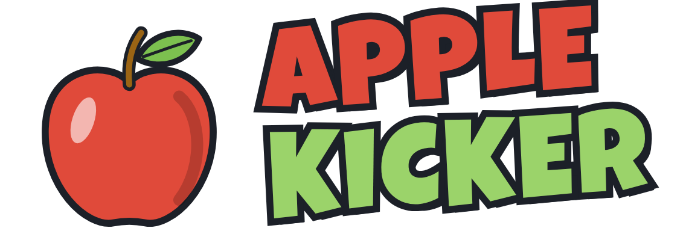

<p align="center"></p>

# Apple Kicker

Ein kleines 3D-Browserspiel: Du stehst auf einem prozedural generierten Feldweg
im goldenen Oktober und kickst deinen Apfel so weit wie möglich den Weg entlang –
während dich von hinten eine Gewitterfront einholt.

*A small 3D browser game: kick your apple down an endless, procedurally generated
autumn country lane before the thunderstorm behind you catches up.*

## Spielen

Du brauchst nur Node.js (≥ 20.19 bzw. ≥ 22.12) und einen Browser mit WebGL.

```bash
npm install
npm run dev
```

Dann die angezeigte Adresse (normalerweise <http://localhost:5173>) im Browser öffnen
und auf **Klicken zum Starten** drücken. Der Mauszeiger wird eingefangen (Pointer Lock),
`Esc` oder `P` pausiert.

Auf schwachen Rechnern `?quality=low` oder `?quality=medium` an die Adresse hängen
(weniger bzw. keine Schatten, kein Antialiasing).

### Steuerung

| Eingabe | Aktion |
| --- | --- |
| `W` `A` `S` `D` | laufen |
| `Shift` | sprinten (begrenzte Ausdauer; ganz leer gesprintet bist du eine Sekunde aus der Puste, danach ist sie wieder voll) |
| Maus | umsehen |
| **Linke Maustaste** halten, ziehen, loslassen | Kick |
| kurzer Klick | kleiner Stupser nach vorn |
| `Leertaste` beim Loslassen halten | hoher Lupfer (über Wurzeln und Baumstämme) |
| `M` | Ton an/aus |
| `P` / `Esc` | Pause (im Pausenmenü: `R` = Neustart) |
| `Enter` / `R` | nach einem verlorenen Leben: weitermachen / neu starten |

Die **Zugrichtung** bestimmt die Schussrichtung (nach oben ziehen = geradeaus),
die **Zuglänge** die Kraft. Der Apfel muss dicht vor deinen Füßen liegen.

#### Touch-Steuerung

Auf Handys und Tablets erscheinen automatisch halbtransparente Bedienelemente:

| Eingabe | Aktion |
| --- | --- |
| Stick hoch / runter | vorwärts / rückwärts laufen (bis über den Rand geschoben = sprinten) |
| Stick links / rechts | nach links / rechts drehen |
| wischen (irgendwo sonst auf dem Bildschirm) | Kick, wie mit der Maus: Wischrichtung = Schussrichtung, Wischlänge = Kraft; kurz tippen = Stupser |
| roter Knopf neben dem Stick halten | hoher Lupfer |
| Pause-Knopf rechts oben | Pause |

### Regeln

* Gezählt werden die Meter, die der **Apfel** entlang des Weges zurücklegt.
* Hinter dir zieht eine Schlechtwetterfront mit Regen und Gewitter heran. Sie wird
  mit der Strecke schneller und lässt zwischendurch wieder nach. Holt sie **dich oder
  deinen Apfel** ein, kostet das ein Leben.
* Kicken macht durstig: Die **Durst-Anzeige** leert sich schnell. Auf dem Weg schweben
  Apfelschorle-Flaschen, jede füllt die Anzeige und
  deine Ausdauer wieder ganz auf. Ist sie leer, bist du
  verdurstet – das kostet ebenfalls ein Leben.
* Im Startmenü wählst du den Modus:
  * **Story**: Der Weg hat ein Ziel – jede Etappe kommt nur einmal. Schaffst du es bis ans Ende?
  * **Endlos**: Der Weg hört nie auf. Dieser Modus wird freigeschaltet, sobald du den
    Story-Modus geschafft hast.
* Außerdem wählst du die Schwierigkeit (in beiden Modi):
  * **Schwer**: ein Leben – eingeholt ist der Lauf vorbei.
  * **Einfach**: drei Leben (oben als Äpfel angezeigt). Nach dem Einholen kannst du
    **weitermachen** – Spieler, Apfel und Gewitter stehen dann wie beim Start auf dem Weg,
    aber bei der Weite, die du schon geschafft hast – oder mit allen Leben **neu starten**.
    Mit **Kickstart** beginnt ein neuer Lauf direkt bei deinem Einfach-Rekord.
* Ist der Apfel mindestens 5 m von dir entfernt, wird er immer markiert, auch wenn
  er im Bild ist.
* Mit der Strecke tauchen immer mehr Hindernisse auf: Wurzeln, Äste, Steine,
  Pfützen, umgestürzte Stämme und Hügel. Kick fester, lupf drüber oder such dir
  einen Weg drum herum.
* Auf den Fahrspuren rollt der Apfel am besten, auf Wiese und Acker bremst er schneller.
* Der Rekord wird für jeden Modus und jede Schwierigkeit getrennt im Browser (localStorage) gespeichert,
  ebenso die Freischaltung des Endlos-Modus.

## Technik

* [three.js](https://threejs.org/) für die 3D-Darstellung, [Vite](https://vite.dev/) + TypeScript für den Build.
* Alles ist prozedural: Die Welt entsteht aus einem Seed (Höhenfeld, Wegverlauf,
  Biome wie Wald, Wiese, Hecke, Acker und Weinberg, Bäume, Hindernisse). Es werden keine
  externen Assets geladen – auch die Geräusche werden mit der Web Audio API synthetisiert.
* Die Physik des Apfels ist eine eigene kleine Kugel-gegen-Höhenfeld-Simulation mit
  Kapsel-, Kugel- und Zylinder-Kollidern für Wurzeln, Stämme, Steine und Bäume.
* Flat-Shading und wenige Polygone sorgen für den stilisierten Low-Poly-Look.

### Scripts

```bash
npm run dev        # Entwicklungsserver
npm run build      # Typprüfung + Produktions-Build nach dist/
npm run preview    # Produktions-Build lokal ansehen
npm run smoke      # Headless-Test mit Chromium (CHROME_PATH auf ein Chrome/Chromium zeigen lassen)
```

Der Produktions-Build in `dist/` ist rein statisch und läuft von jedem Webserver
(auch aus einem Unterverzeichnis, z. B. GitHub Pages).

### Logo

Das Logo nutzt die Schrift [Luckiest Guy](https://fonts.google.com/specimen/Luckiest+Guy)
von Astigmatic (Apache License 2.0), lokal eingebunden unter `public/fonts/`.
Der Apfel aus dem Logo ist zugleich das Favicon (`public/favicon.svg`).
